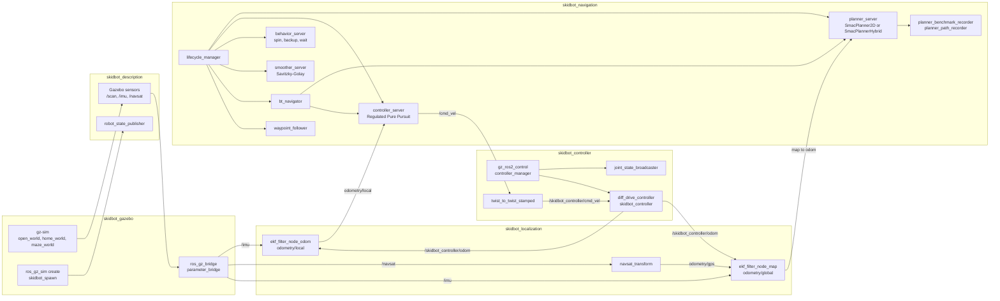
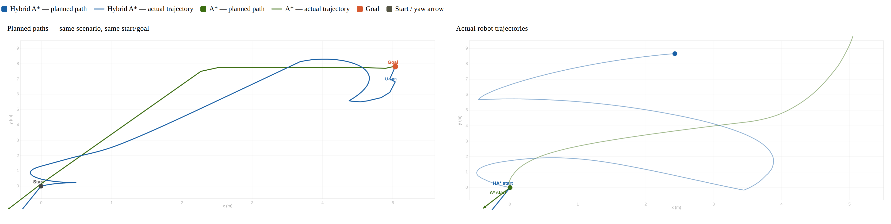
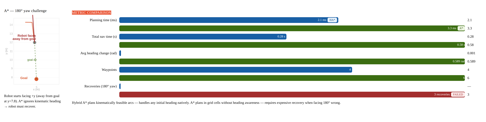

# Skidbot

ROS 2 Jazzy Gazebo simulation of a 4-wheel skid-steer robot that fuses wheel odometry, IMU, and GPS, then benchmarks Nav2 A\* against Hybrid A\* in an outdoor world.

<!-- TODO: Gazebo outdoor simulation GIF -->
<!-- TODO: RViz Nav2 screenshot -->

This repository is the simulation behind the paper: K. F. Wassef, "Implementation and Evaluation of Cost-Aware Hybrid-A\* Path Planning for a Skid-Steer Mobile Robot in Indoor Environments," Dept. of Mechatronics Engineering, Ain Shams University, 2026.

## What this demonstrates

- ROS 2 Jazzy workspace with five `ament_cmake` packages and Python nodes
- URDF/Xacro modeling, meshes, and Gazebo Harmonic sensors (2D LiDAR, IMU, NavSat)
- `gz-sim` worlds, `ros_gz_bridge`, and `gz_ros2_control`
- `ros2_control` diff-drive for a 4-wheel skid-steer
- `robot_localization` dual EKF plus `navsat_transform` (wheel odometry, IMU, GPS)
- Nav2 SMAC 2D A\*, SMAC Hybrid A\* (Reeds-Shepp), Regulated Pure Pursuit, behavior trees, costmaps, and a lifecycle manager
- Planner benchmark logging to CSV (planning time, path length, recoveries, trajectory)

## Architecture

The running stack is four launch files. Optional Mapviz and waypoint tools are listed under the diagram.



`open_world.launch.py` starts gz-sim, spawns the robot from the xacro, runs `robot_state_publisher`, the bridge, and RViz. The bridge carries `/clock`, `/odom`, `/joint_states`, `/tf`, `/tf_static`, `/imu`, `/scan`, and `/navsat`. `gz_ros2_control` hosts `controller_manager` inside the simulation. The odom EKF fuses `/skidbot_controller/odom` with `/imu` and publishes `odometry/local`. The map EKF adds `odometry/gps` from `navsat_transform` and publishes `odometry/global`. Nav2's controller reads `odometry/local`. `planner:=astar` loads `SmacPlanner2D`; `planner:=hybrid_astar` loads `SmacPlannerHybrid`.

Also in the repo, launched separately: `mapviz`, `initialize_origin.py`, and a static `map` to `origin` transform (`mapviz.launch.py`); `gps_waypoint_logger`, `gps_wp_commander` (`interactive_waypoint_follower.py`), and `logged_waypoint_follower.py`.

## Simulation status

| Piece | Package | State in this repo |
|---|---|---|
| Outdoor open world (Rubicon terrain, WGS84 datum) | `skidbot_gazebo` | Launchable; used for the checked-in planner runs |
| Indoor home world (local apartment model) | `skidbot_gazebo` | Launchable |
| Maze world (Gazebo Fuel maze) | `skidbot_gazebo` | Launchable |
| 4-wheel skid-steer URDF, meshes, LiDAR / IMU / NavSat | `skidbot_description` | In the model |
| Diff-drive via `gz_ros2_control` | `skidbot_controller` | Simulated `GazeboSimSystem` |
| Dual EKF and GPS conversion | `skidbot_localization` | Wheel odometry + IMU + NavSat |
| Switchable A\* and Hybrid A\* Nav2 stack | `skidbot_navigation` | `planner:=astar` or `planner:=hybrid_astar` |
| Benchmark CSVs and figures | `skidbot_navigation/planner_results` | Open-world runs checked in |

## Quick start

ROS 2 Jazzy on Ubuntu 24.04. Gazebo and RViz open a GUI, so use a machine with a display. The first `open_world` and `maze_world` launches download a model from Gazebo Fuel.

```bash
source /opt/ros/jazzy/setup.bash
sudo rosdep init   # once per machine
rosdep update
mkdir -p ~/skidbot_ws/src
git clone https://github.com/KroNton/skidbot-robot.git ~/skidbot_ws/src/skidbot-robot
cd ~/skidbot_ws
rosdep install --from-paths src --ignore-src -y
sudo apt install -y \
  ros-jazzy-nav2-bringup \
  ros-jazzy-nav2-smac-planner \
  ros-jazzy-nav2-regulated-pure-pursuit-controller \
  ros-jazzy-robot-localization \
  ros-jazzy-ros-gz-bridge \
  ros-jazzy-ros-gz-sim \
  ros-jazzy-ros2-control \
  ros-jazzy-gz-ros2-control \
  ros-jazzy-diff-drive-controller \
  ros-jazzy-joint-state-broadcaster \
  ros-jazzy-robot-state-publisher \
  ros-jazzy-mapviz \
  ros-jazzy-mapviz-plugins \
  ros-jazzy-swri-transform-util \
  ros-jazzy-xacro \
  ros-jazzy-rviz2
colcon build --symlink-install
source install/setup.bash
```

Source the workspace in every terminal, then start the stack in this order:

```bash
# Terminal 1 — outdoor world used for the benchmarks
ros2 launch skidbot_gazebo open_world.launch.py

# Terminal 2 — diff-drive controller and Twist relay
ros2 launch skidbot_controller controller.launch.py

# Terminal 3 — dual EKF and navsat_transform
ros2 launch skidbot_localization localization.launch.py

# Terminal 4 — Nav2 with Hybrid A* (planner:=astar selects SMAC 2D A*)
ros2 launch skidbot_navigation nav2.launch.py planner:=hybrid_astar
```

Other worlds: `ros2 launch skidbot_gazebo home_world.launch.py` and `ros2 launch skidbot_gazebo maze_world.launch.py`. Send a goal with the RViz **2D Goal Pose** tool. Optional GPS view: `ros2 launch skidbot_localization mapviz.launch.py`. Record a run while navigating: `ros2 run skidbot_navigation planner_benchmark_recorder`.

## Results

Checked-in open-world runs in [`skidbot_navigation/planner_results/planner_results.csv`](skidbot_navigation/planner_results/planner_results.csv). Planned paths are in `plan_paths.csv` and executed trajectories in `robot_trajectories.csv`.

| Planner | Runs | Success | Recoveries | Mean planning time |
|---|---|---|---|---|
| Hybrid A\* (`SmacPlannerHybrid`) | 2 | 2/2 | 0 | 3.5 ms |
| A\* (`SmacPlanner2D`) | 4 | 3/4 | 3 | 2.5 ms |

The unsuccessful A\* run recorded 3 recoveries and then aborted. Hybrid A\* completed both runs with no recoveries. Figures from those logs:





---

## Overview

Skidbot is a simulated skid-steer robot built for evaluating kinematically feasible path planning in indoor environments. The robot runs in Gazebo Harmonic and is navigated by the Nav2 stack using either the standard SMAC 2D A\* planner or the SMAC Hybrid A\* planner (SE(2) state space). A dual Extended Kalman Filter fuses wheel odometry, IMU, and GPS to produce both local (`odom`) and global (`map`) pose estimates. Benchmarking nodes record per-run planning metrics, planned path waypoints, and actual robot trajectories to CSV for offline analysis.

This repository accompanies the paper:
> K. F. Wassef, "Implementation and Evaluation of Cost-Aware Hybrid-A\* Path Planning for a Skid-Steer Mobile Robot in Indoor Environments," Dept. of Mechatronics Engineering, Ain Shams University, 2026.

---

## Robot Specifications

| Parameter | Value |
|---|---|
| Chassis (L × W × H) | 0.80 m × 0.389 m × 0.171 m |
| Chassis mass | 18.71 kg |
| Total mass (all links) | ~40.0 kg |
| Wheel radius | 0.108 m |
| Wheel width | 0.060 m |
| Track width (wheel separation) | 0.666 m |
| Wheelbase (front–rear axle) | 0.763 m |
| Drive type | 4-wheel skid-steer |
| Max linear speed | 1.0 m/s |
| Max angular speed | 4.0 rad/s |

---

## Sensor Suite

| Sensor | ROS Topic | Rate | Role |
|---|---|---|---|
| 2D LiDAR (360°, 12 m) | `/scan` | — | Obstacle detection, costmap updates |
| IMU | `/imu` | 100 Hz | Orientation, EKF yaw fusion |
| Wheel encoders | `/skidbot_controller/odom` | 50 Hz | Odometry, EKF velocity fusion |
| GPS / NavSat | `/navsat` | 10 Hz | Global position (EKF map-frame anchor) |

---

## Prerequisites

| Requirement | Version |
|---|---|
| ROS 2 | Jazzy |
| Gazebo | Harmonic (gz-sim 8) |

Key ROS packages (install via `apt`):

```bash
sudo apt install \
  ros-jazzy-nav2-bringup \
  ros-jazzy-nav2-smac-planner \
  ros-jazzy-nav2-regulated-pure-pursuit-controller \
  ros-jazzy-robot-localization \
  ros-jazzy-ros-gz-bridge \
  ros-jazzy-ros-gz-sim \
  ros-jazzy-ros2-control \
  ros-jazzy-gz-ros2-control \
  ros-jazzy-diff-drive-controller \
  ros-jazzy-joint-state-broadcaster \
  ros-jazzy-robot-state-publisher \
  ros-jazzy-mapviz \
  ros-jazzy-mapviz-plugins \
  ros-jazzy-swri-transform-util
```

---

## Repository Structure

```
skidbot-robot/
├── skidbot_description/    # URDF/Xacro robot model, meshes, RViz config
├── skidbot_gazebo/         # SDF simulation worlds, ROS–Gazebo bridge config, world launchers
├── skidbot_controller/     # ros2_control diff-drive controller, twist relay node
├── skidbot_localization/   # Dual EKF (odom + map), NavSat GPS transform, Mapviz launcher
└── skidbot_navigation/     # Nav2 stack, planner configs, behavior trees, benchmarking nodes
```

---

## Build

```bash
cd ~/skidbot_ws
colcon build --symlink-install
source install/setup.bash
```

---

## Running

Each step requires its own terminal. Source the workspace in every terminal before running.

### Terminal 1 — Gazebo simulation

Choose one environment:

```bash
# Open terrain — used for the planner benchmarks in the paper
ros2 launch skidbot_gazebo open_world.launch.py

# Indoor home environment
ros2 launch skidbot_gazebo home_world.launch.py

# Maze environment
ros2 launch skidbot_gazebo maze_world.launch.py
```

This launches Gazebo, spawns the robot, starts the ROS–Gazebo topic bridge, and opens RViz.

### Terminal 2 — Controllers

```bash
ros2 launch skidbot_controller controller.launch.py
```

Starts the `diff_drive_controller` (ros2_control) and a Twist → TwistStamped relay node.

### Terminal 3 — Localization

```bash
ros2 launch skidbot_localization localization.launch.py
```

Starts two EKF nodes:
- `ekf_filter_node_odom` — fuses odometry + IMU → publishes `odometry/local` (odom frame)
- `ekf_filter_node_map` — fuses odometry + IMU + GPS → publishes `odometry/global` (map frame)

### Terminal 4 — Navigation

Choose a planner:

```bash
# Hybrid A* (kinematically feasible, SE(2) state space) — recommended for skid-steer
ros2 launch skidbot_navigation nav2.launch.py planner:=hybrid_astar

# Grid A* (SMAC 2D, 8-connected grid)
ros2 launch skidbot_navigation nav2.launch.py planner:=astar
```

Once Nav2 is active, use the **2D Goal Pose** tool in RViz to send navigation goals.

### Optional — GPS Mapviz visualization

```bash
ros2 launch skidbot_localization mapviz.launch.py
```

---

## Planner Benchmarking

The `skidbot_navigation` package includes nodes that record per-run planning and navigation metrics.

**Record a benchmark run** (in a separate terminal, while the robot is navigating):

```bash
ros2 run skidbot_navigation planner_benchmark_recorder
```

Results are saved to `skidbot_navigation/planner_results/`:

| File | Contents |
|---|---|
| `planner_results.csv` | Per-run metrics: planning time, path length, heading changes, recoveries, success, nav time |
| `plan_paths.csv` | Full planned-path waypoint sequences (x, y, yaw per pose) |
| `robot_trajectories.csv` | Actual robot trajectory samples during execution |

### Open-world results summary

Tests were run in the open-world environment only. Results from the paper:

| Planner | Runs | Success | Recoveries | Avg plan time |
|---|---|---|---|---|
| Hybrid A\* | 2 | 2/2 (100%) | 0 | 3.5 ms |
| A\* | 4 | 3/4 (75%) | 3 (one failed run) | 2.5 ms |

The A\* failure was caused by the robot facing 180° away from the goal — NavFn ignores initial heading, forcing the Regulated Pure Pursuit controller into repeated recovery maneuvers before aborting.

---

## Package Descriptions

### `skidbot_description`
Defines the robot model in URDF/Xacro. Contains the main `skidbot.xacro` (chassis, arms, wheels, inertia), Gazebo sensor plugins (`skidbot.gazebo`), and the ros2_control joint interfaces (`skidbot_ros2_control.xacro`). Meshes are provided as DAE files. The launch file starts `robot_state_publisher` and optionally opens RViz.

### `skidbot_gazebo`
Three SDF simulation worlds (open, home, maze) with a shared ROS–Gazebo bridge config (`skidbot_ros_bridge.yaml`) that maps eight topics: `/clock`, `/odom`, `/joint_states`, `/tf`, `/tf_static`, `/imu`, `/scan`, `/navsat`. Each world has its own launch file that starts Gazebo, spawns the robot, starts the bridge, and opens RViz.

### `skidbot_controller`
Configures the `diff_drive_controller` from ros2_control for the 4-wheel skid-steer drive. The controller YAML sets wheel geometry (radius 0.108 m, separation 0.666 m) and velocity/acceleration limits. A `twist_to_twist_stamped.py` relay node bridges the Nav2 `/cmd_vel` (Twist) output to the controller's TwistStamped input.

### `skidbot_localization`
Runs two instances of the `robot_localization` EKF — one anchored to the `odom` frame (odometry + IMU) and one to the `map` frame (odometry + IMU + GPS). A `navsat_transform_node` converts raw GPS fixes to Cartesian odometry. The Mapviz launcher adds a 2D GPS overlay for visualising waypoint routes.

### `skidbot_navigation`
Holds all Nav2 configuration: planner YAMLs for A\* and Hybrid A\*, Regulated Pure Pursuit controller config, costmap settings, recovery behavior config, and two behavior tree XMLs (one per planner). Python nodes in the package provide GPS waypoint logging, interactive waypoint following from Mapviz clicks, and the planner benchmarking recorders that produce the CSV results files.

---

## Key Configuration Files

| File | Purpose |
|---|---|
| `skidbot_controller/config/skidbot_controller.yaml` | Wheel geometry, velocity/acceleration limits |
| `skidbot_localization/config/dual_ekf_navsat_params.yaml` | EKF sensor fusion config for both frames |
| `skidbot_navigation/config/planner_hybrid_astar.yaml` | Hybrid A\* tuning (turning radius, angle bins, cost penalty) |
| `skidbot_navigation/config/planner_astar.yaml` | SMAC 2D A\* tuning |
| `skidbot_navigation/config/controller.yaml` | Regulated Pure Pursuit controller params |
| `skidbot_gazebo/config/skidbot_ros_bridge.yaml` | Gazebo ↔ ROS 2 topic bridge mappings |
